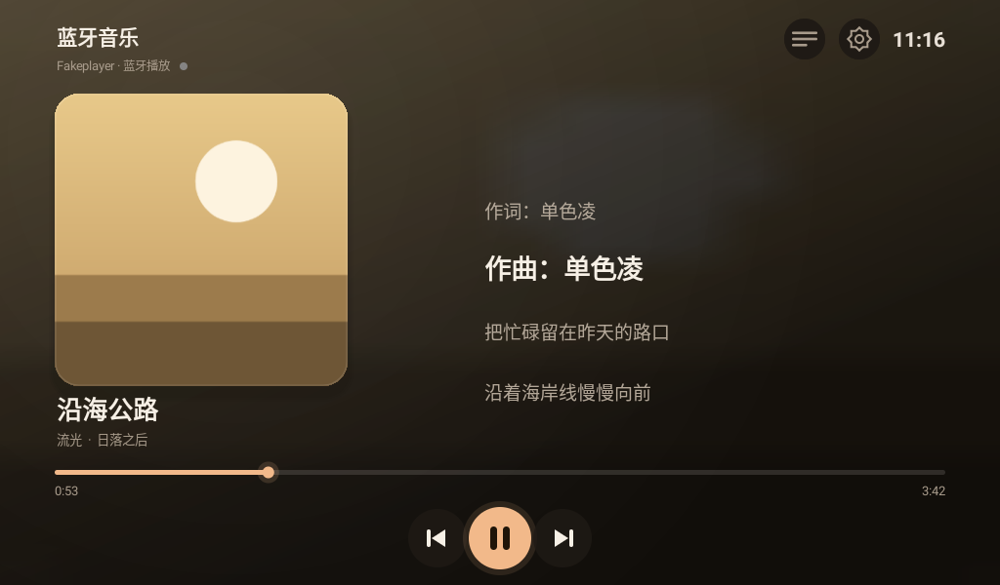
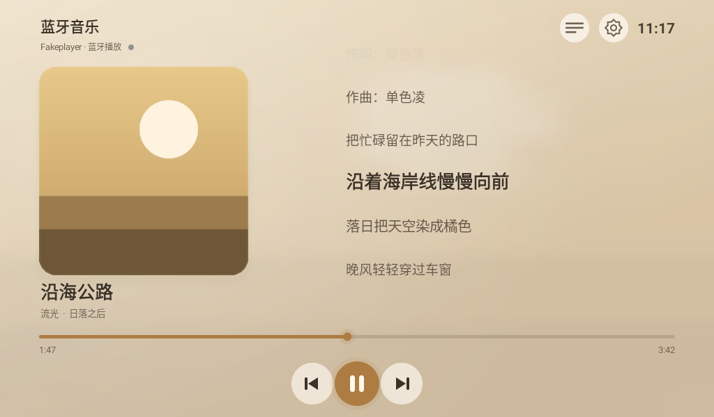
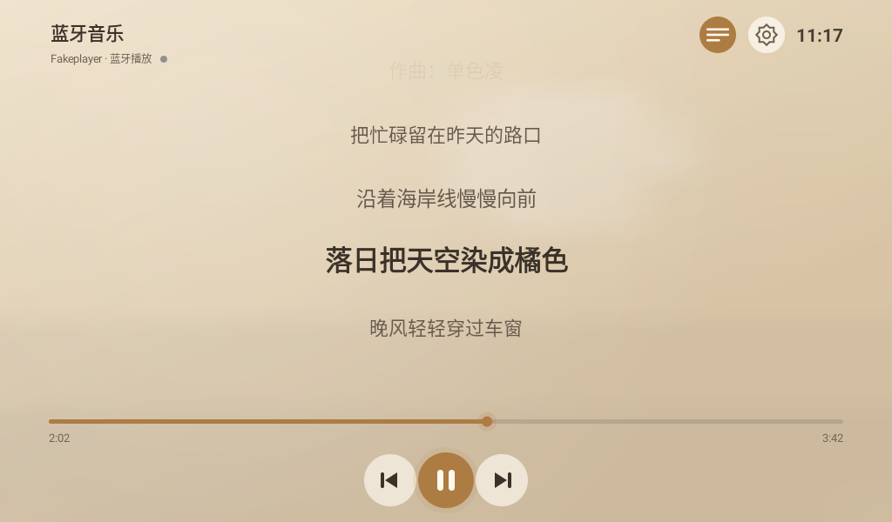
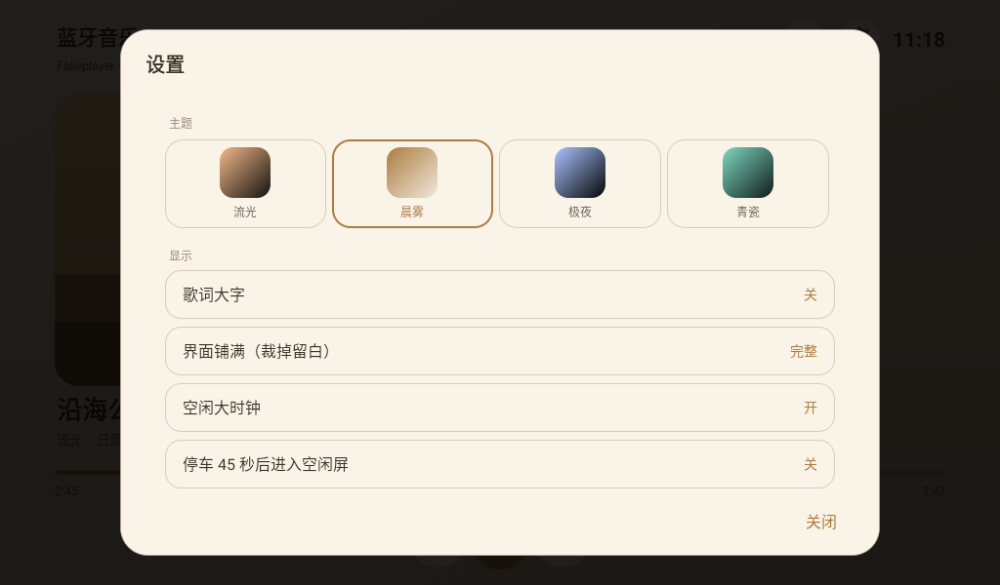
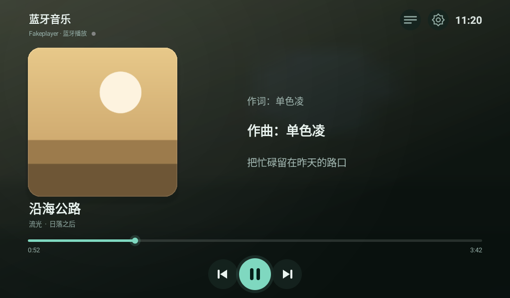
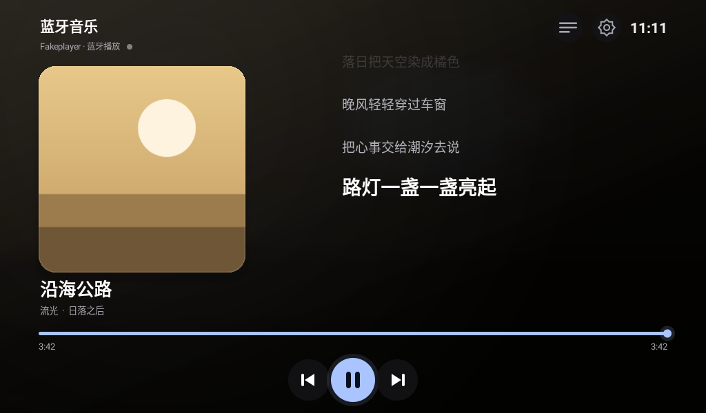
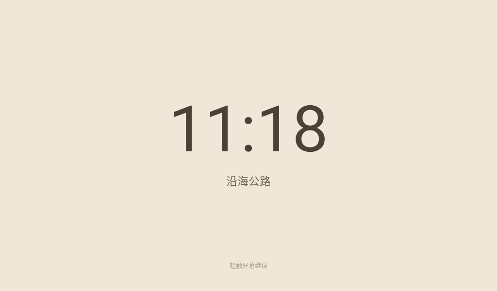
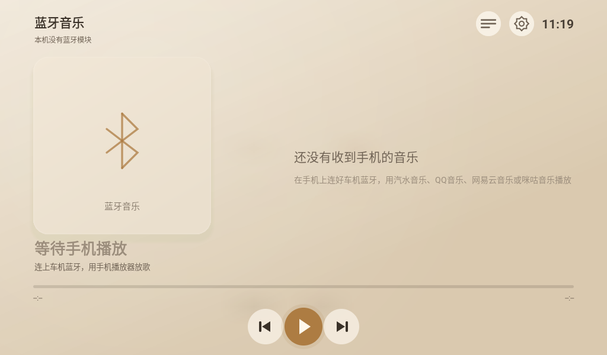

# 流光车机音乐 · 0.5.0

[](https://github.com/s1van7/LiuguangDrive/actions/workflows/ci.yml)
[](https://github.com/s1van7/LiuguangDrive/releases/latest)
[](LICENSE)

面向 Android 9 / 1024×600 车机的**纯显示端**音乐界面。手机通过蓝牙放歌，车机屏幕完整显示歌名、歌手、专辑、封面、进度和歌词。

Java + 系统 Canvas 手绘，无 WebView、无第三方运行时、无原生库、**没有网络权限**。全部代码 14 个文件、单包、零依赖，APK 约 53 KB。

---

## 它到底是怎么拿到数据的

手机用蓝牙放歌时，车机拿不到音频流，只能拿到系统里的两样东西：

1. **媒体通知**：`NotificationListenerService` 读到的、带 `MediaSession` 的那条通知；
2. **媒体会话**：通知里携带的 `MediaSession.Token`，用它建 `MediaController` 读元数据与播放状态。

本项目的取数链路：

```
手机播放器 → 媒体通知(Notification) → MediaAccessService 缓存快照
                                    → MediaSession.Token → MediaController
                                                          → 歌名/歌手/专辑/封面/时长/进度/播放状态
                                                          → MediaMetadata 里的 DISPLAY_SUBTITLE 等 → 歌词
                                    → 通知正文(text/subText/bigText) → 歌词兜底
```

`MediaController` 的元数据是本地缓存的，读它不走 Binder，所以 250 ms 一次的界面刷新不会造成跨进程压力；播放位置按 `PlaybackState` 的时间戳外推，进度条是连续的。

已适配（按包名识别并显示来源）：**汽水音乐、QQ音乐、网易云音乐、咪咕音乐**、酷狗、酷我、喜马拉雅、YouTube Music、Spotify。未知播放器会显示包名末段，功能不受影响。

---

## 歌词是怎么来的（重要，别被"蓝牙传歌词"骗了）

蓝牙 AVRCP 协议**只传歌曲信息，不传歌词**。车机上能看到的歌词，全部是播放器自己塞进媒体信息里的：

| 通道 | 说明 |
|---|---|
| 整份 LRC | 少数播放器把整份带时间戳的歌词放进 `MediaMetadata` 的自定义键（键名含 `lyric`/`lrc`），有就直接用，最准 |
| `DISPLAY_SUBTITLE` | 开了"车载歌词"的播放器会把**当前这一句**写进这个字段，换句时再改一次 |
| 媒体通知正文 | 同上，只是写在 `subText`/`text`/`bigText` 里 |

所以本项目做的是**边听边拼**：

- 每看到一句新词，就把当时的播放位置记成它的时间戳，拼成时间轴（`LyricStream`）；
- 同一句连续重复上报会被识别为"还没换句"，不会重复显示；
- 副歌再来一遍（间隔 > 15 秒）记成新的一行，位置正确；
- 唱完最后一句后位置继续走，不会误判成新的一句；
- 又从头放一遍时，旧时间轴对不上就自动作废重建，避免同一句出现两次；
- 时间轴攒到 3 句以上就落盘到本机（`LyricCache`），**下一遍再放这首歌立刻就有整首歌词**。

这套逻辑在模拟器上用真实 `MediaSession` + 媒体通知验证过：第一遍逐句累积，第二遍打开就有完整时间轴。

**如果歌词一直是空的**，说明播放器没把歌词写进媒体信息。去播放器设置里打开"车载歌词"或"蓝牙歌词"开关（QQ音乐、网易云、咪咕都有），再播放即可。

---

## 界面

参考手机播放器的沉浸式播放页：

- 整屏是封面放大模糊后的底色，叠加主题色；
- 左侧 300×300 大圆角封面、歌名、歌手 · 专辑；
- 右侧歌词纵向居中、偏右排列，当前句最大最亮，上下句依次缩小淡出，到边界柔和消失（不会出现被切一半的字）；
- 底部细进度条 + 三个圆形按钮；
- 右上角两个圆形按钮：沉浸歌词、设置；时钟可直接点进空闲屏。

**五套主题**（设置里切换，即时生效）：曜石（现代石墨灰 + 青绿色）、流光（暖金深色）、晨雾（米白浅色）、极夜（纯黑）、青瓷（墨绿）。

**操作**：触摸；也支持方向盘/旋钮——方向键做空间导航（焦点环），确认键执行，返回键逐层退出，媒体键直接控制播放。

---

## 截图

模拟器实测，界面数据全部来自真实 `MediaSession` + 媒体通知链路（用临时"模拟播放器"逐句推送），不是画的示意图。

| 流光主题 · 播放中 | 晨雾主题 · 播放中 |
|---|---|
|  |  |

| 沉浸歌词 | 设置与主题 |
|---|---|
|  |  |

| 青瓷主题 | 极夜主题 |
|---|---|
|  |  |

| 空闲大时钟 | 等待连接 |
|---|---|
|  |  |

---

## 目录结构

```
src/cn/liuguang/drive/
  MainActivity.java       唯一界面 + 全部业务（会话绑定、元数据、歌词、面板）
  PlayerView.java         1024×600 全屏绘制、命中区、按键导航、离屏缓存
  PlayerModel.java        界面只读的播放状态
  MediaAccessService.java 媒体通知监听（只认带 MediaSession 的通知）
  LyricStream.java        歌词时间轴拼接（纯 Java，可测）
  LyricProbe.java         判断一段文字是歌词还是歌曲信息（纯 Java，可测）
  LrcParser.java          无依赖 LRC 解析（纯 Java，可测）
  LyricCache.java         歌词时间轴落盘
  SessionPick.java        多播放器时挑显示哪个会话（纯 Java，可测）
  AppProfile.java         播放器包名 → 名称/品牌色
  Theme.java              四套配色
  Panels.java / Sheet.java 面板组件与自绘模态卡片
  BluetoothStatus.java    只读 A2DP 连接状态
  CrashLog.java           崩溃落盘
```

---

## 构建

不需要 Gradle。设置 `ANDROID_HOME` 后直接：

```bash
bash build.sh          # aapt → javac → d8 → zipalign → apksigner
bash tests/run.sh      # 纯 JVM 自检，73 项断言，不需要设备
```

依赖只有 `platforms;android-28` 和 `build-tools;34.0.0`。

### 签名与覆盖安装

APK 用仓库里的 `signing/liuguang-release.jks` 签名（别名 `liuguang`，密码 `liuguang-local-build`）。**这个文件必须提交**：Android 只允许同签名的包覆盖安装，签名一变就只能先卸载，设置和歌词缓存全丢。

- 升级版本时记得同时改 `AndroidManifest.xml` 的 `versionCode`（必须递增）和 `build.sh` 里的 `VERSION`；
- CI 产出的 APK 和 Release 里的 APK 用同一把密钥，所以从 Actions 下载的包也能直接盖在已装版本上；
- 想换成自己的密钥：`SIGNING_KEYSTORE=/path/to.jks SIGNING_PASSWORD=*** bash build.sh`，但换过之后老用户必须卸载一次。

> 密钥是公开的，这意味着别人也能签一个同名的包。本项目没有联网权限、只读媒体信息，风险可控；如果你要正式分发，把密钥挪到 GitHub Secrets 里，别提交。

---

## 开机启动

0.5.0 增加可选的「开机自动启动」设置，默认关闭。开启后，Android 9 在系统发送 `BOOT_COMPLETED` 广播时尝试启动主界面；部分车机固件可能限制开机拉起应用，实际行为需在目标设备验证。

---

## 隐私

- 只有 `BLUETOOTH` / `BLUETOOTH_ADMIN` 两个权限，**没有 INTERNET**；
- 通知监听只处理带 `MediaSession` 或 `category=transport` 的通知，聊天、短信、其他通知一律不读；
- 不配对、不读 MAC、不上传任何数据；歌词缓存只存在本机 `filesDir`。

---

## 已知限制

- **没有在真车上验证过**。模拟器没有真实蓝牙栈，真实元数据读取需要实车试。若原厂界面有歌名而这里没有，说明该车机没把蓝牙媒体暴露成标准 `MediaSession`，需要厂商 SDK。
- 歌词依赖播放器主动上报。播放器不提供就没有，本软件不会联网去搜歌词（也没有网络权限）。
- 第一次听某首歌时歌词只能逐句出现，放完一遍后才有完整时间轴。
- 部分车机的媒体通知不带 `MediaSession.Token`，会退回 `MediaSessionManager.getActiveSessions()`；若该接口被厂商限制，则无法读取。
- 签名固定为仓库里的 `signing/liuguang-release.jks`，从 0.4.0 起可直接覆盖安装，不需要先卸载。
